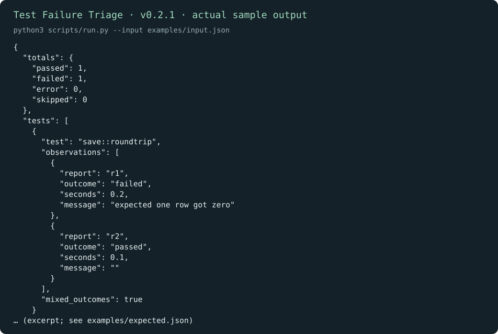

# Test Failure Triage

English | [简体中文](README.zh-CN.md)

Read several JUnit reports together and see which tests keep failing or change outcome between runs. Each observation stays tied to its report, duration, and failure message.

[Download v0.2.1](https://github.com/KarmenLoop/skill-test-failure-triage/releases/tag/v0.2.1) · [Tutorial](docs/tutorial.en.md) · [Input reference](docs/INPUT.md) · [Report an issue](https://github.com/KarmenLoop/skill-test-failure-triage/issues)

## What it does

save::roundtrip fails once and passes once. totals records both observations and mixed_outcomes is true.

Mixed outcomes are a lead for investigation, not proof of flakiness. This helper reads report XML; it never runs or repairs the tests.



*Actual local output from v0.2.1, rendered as an image. [Complete result](examples/expected.json) · [Image provenance](docs/images/provenance.json).*

## Start here

Download `karmen-test-failure-triage-v0.2.1.zip` and its `.sha256` file from the release, verify the hash, then extract the ZIP. In the extracted directory, use Python 3.9 or later:

```sh
python3 scripts/run.py --version
python3 scripts/run.py --input examples/input.json
```

Expected version: `karmen-test-failure-triage 0.2.1`. save::roundtrip fails once and passes once. totals records both observations and mixed_outcomes is true.

To install the complete skill into a host that reads `~/.agents/skills`:

```sh
python3 install.py --host agents
```

The installer refuses an existing destination. Host discovery and invocation vary; see the [full setup and practice guide](docs/tutorial.en.md). You can run the helper directly without an AI host.

## Use it with your own work

Give each report a unique ID and its XML text. Use the testcase entries as evidence; DTDs and entity declarations are rejected.

Add a third report from a known revision and compare the messages. Keep commit, environment, and command alongside the report when investigating a mixed outcome.

Read the [field contract](docs/INPUT.md) before preparing a new input. The helper runs locally with the Python standard library; it needs no model account, API key, or network connection. An AI host has its own data and permission settings.

## Questions

**Does mixed_outcomes mean I can ignore the failure?** No. Check revision and environment differences, reproduce deliberately, and fix the underlying issue before changing the test’s status.

**Where does the result go?** JSON is printed to stdout unless you request a new file with `--output`. Existing output files are preserved. The helper reads only the submitted records and any local paths documented in its input contract.

## Documentation and support

- [Download, install, configure, practice, upgrade, and remove](docs/tutorial.en.md)
- [Input/output contract](docs/INPUT.md) and [compatibility](docs/COMPATIBILITY.md)
- [Changelog](CHANGELOG.md), [contributing](CONTRIBUTING.md), [support](SUPPORT.md), and [security reports](SECURITY.md)

## License

[MIT](LICENSE). Keep the license and [notice](NOTICE.md) with redistributed copies. Maintained by [KarmenLoop](https://karmenloop.com).
