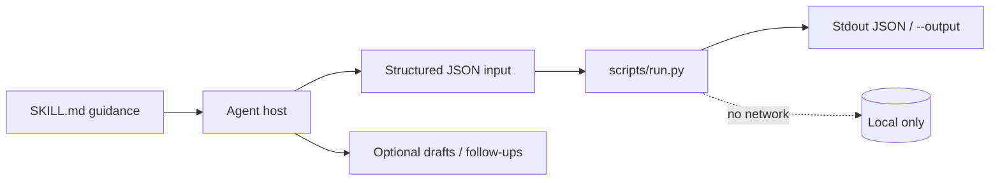
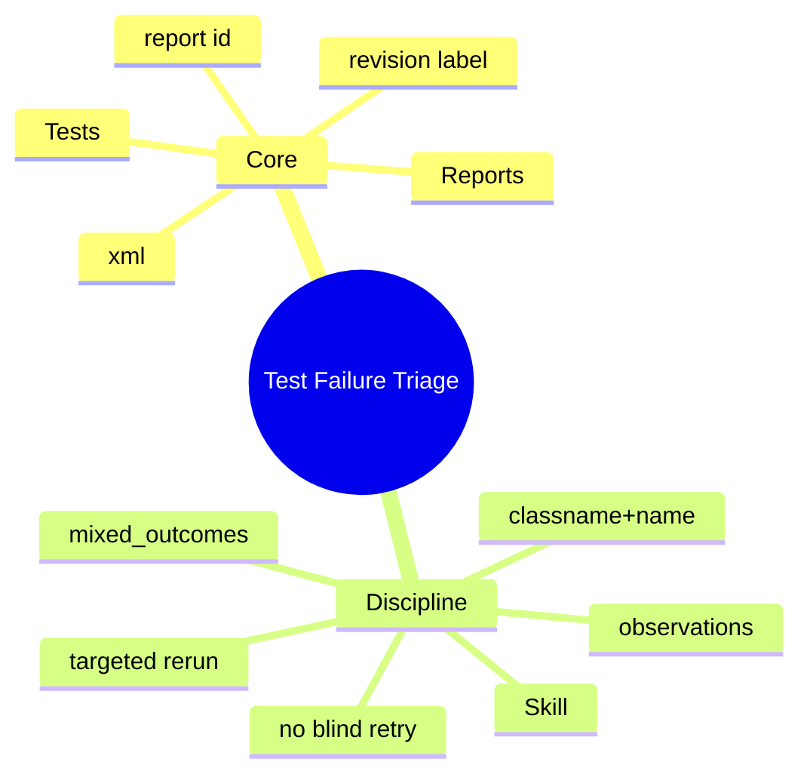

# Test Failure Triage

[English](README.md) · [中文](README.zh-CN.md) · **v0.2.1**

[](https://github.com/KarmenLoop/skill-test-failure-triage/actions/workflows/checks.yml)
[](https://github.com/KarmenLoop/skill-test-failure-triage/releases/latest)
[](https://www.python.org/downloads/)
[](LICENSE)
[](docs/COMPATIBILITY.md)

**Read several JUnit reports together—see which tests keep failing or flip outcomes between runs.**

An agent skill plus a local JUnit aggregator: each observation stays tied to its report, duration, and failure message. You keep the export (or transcript, diff, ledger, event log, or JUnit XML) local; the helper stays on the standard library and never opens a network connection. The skill layer teaches a host *when* to prepare input, *how* to narrate results, and *where* to stop before side effects the user did not authorize.

Built and maintained by [KarmenLoop](https://github.com/KarmenLoop) / [KARMENLOOP](https://karmenloop.com). Current release: **[v0.2.1](https://github.com/KarmenLoop/skill-test-failure-triage/releases/tag/v0.2.1)**. License: **MIT**.


*Actual local output from v0.2.1, rendered as an image. [examples/expected.json](examples/expected.json) · [Image provenance](docs/images/provenance.json).*

[Download v0.2.1](https://github.com/KarmenLoop/skill-test-failure-triage/releases/tag/v0.2.1) · [Tutorial](docs/tutorial.en.md) · [中文教程](docs/tutorial.zh-CN.md) · [Input contract](docs/INPUT.md)

---

## Why this exists

CI UIs flatten failures. Flaky and deterministic defects look the same until someone diffs runs by hand.

This helper parses multiple report XML blobs, groups by test identity, and flags `mixed_outcomes` when the same test both fails and passes across the supplied set—**a lead for investigation, not proof of flakiness**.

The skill pushes isolation checks, clock assumptions, and shared-resource cleanup before anyone weakens assertions or adds blind retries.

---

## Snapshot

| | |
|---|---|
| **What you install** | Skill tree + `scripts/run.py` JUnit aggregator + `install.py` |
| **Runtime** | Python **3.9+**, standard library only |
| **Network** | **None** — never runs or repairs tests |
| **Input** | UTF-8 JSON: `reports[]` (`id`, `xml`); DTDs/entities rejected |
| **Output** | `tests[]` with observations + `mixed_outcomes`; `totals` from testcase outcomes |
| **Install hosts** | `codex` · `deepseek` · `grok` · `agents` |
| **Package id** | `karmen-test-failure-triage` |
| **License** | MIT |

---

## Is / Is not

| Is | Is not |
|---|---|
| Multi-report JUnit aggregation | A test runner or flaky-quarantine service |
| Mixed-outcome leads with messages preserved | Proof that a test is flaky |
| DTD/entity rejection for safer XML | Remote log fetch from CI |
| Offline stdlib helper | Automatic code repair |
| Skill guidance for smallest targeted rerun | Authority to mute failures in CI |

---

## How it works

Two layers stay separate on purpose:

1. **Method layer (`SKILL.md`)** — when to invoke, how to prepare honest input, what to deliver, and which side effects stay forbidden without fresh user authorization.
2. **Deterministic helper (`scripts/run.py`)** — validates a UTF-8 JSON contract (max 10 MiB), computes the result locally, prints JSON to stdout (or a new `--output` file), and exits `2` on invalid input.





### Workflow

1. **Collect** reports with revision, command, exit code, and runner environment. Parsing success is not suite success.
2. **Run** the helper on all selected reports. Inspect failing messages and related logs before one-cause attribution.
3. **For mixed outcomes**, test isolation, clocks, shared resources, and cleanup. Avoid masking deterministic bugs with retries.
4. **Return** the smallest targeted rerun and likely ownership—then run it only within the requested diagnostic scope.

### What the sample proves

`save::roundtrip` fails once and passes once. `totals` records both; `mixed_outcomes` is true.

Exit `0` means processing finished—not that every business finding “passed.”

---

## Quickstart

Download `karmen-test-failure-triage-v0.2.1.zip` and its `.sha256` from the [v0.2.1 release](https://github.com/KarmenLoop/skill-test-failure-triage/releases/tag/v0.2.1), verify the hash, and extract. Requires Python 3.9+.

```sh
python3 scripts/run.py --version
python3 scripts/run.py --input examples/input.json
```

Expected version string: `karmen-test-failure-triage 0.2.1`.

Optional: install into a host that scans a skills directory (installer refuses an existing destination):

```sh
python3 install.py --host agents
# also: --host codex | deepseek | grok
# or:  --destination /exact/new/directory
```

You can run the helper with no AI host at all. Host discovery and invocation still vary—see [docs/tutorial.en.md](docs/tutorial.en.md) and [docs/COMPATIBILITY.md](docs/COMPATIBILITY.md).

Pipe mode and version probe:

```sh
python3 scripts/run.py --input - < examples/input.json
python3 scripts/run.py --version
```

---

## Use it with your own work

Read [docs/INPUT.md](docs/INPUT.md) before shaping a new payload.

- Give each report a unique id and raw XML text.
- Add a third report from a known revision when investigating mixes.
- Keep commit, environment, and command beside the report.
- Repeated identities may be parameter collisions—inspect manually.

The helper needs no model account, API key, or network. An AI host has its own data and permission settings; this skill adds no authority to send, purchase, publish, or change access.

---

## Documentation map

| Doc | Use it when you need… |
|---|---|
| [Tutorial (EN)](docs/tutorial.en.md) · [中文](docs/tutorial.zh-CN.md) | Download, install, practice, upgrade, remove |
| [Input / output contract](docs/INPUT.md) · [中文](docs/input.zh-CN.md) | Field semantics and examples |
| [Compatibility](docs/COMPATIBILITY.md) | Host install paths and unverified boundaries |
| [Validation](docs/VALIDATION.md) | What was actually exercised |
| [Sources](docs/SOURCES.md) | Research notes behind the design |
| [Changelog](CHANGELOG.md) | Release history |
| [Contributing](CONTRIBUTING.md) · [Support](SUPPORT.md) · [Security](SECURITY.md) | Collaboration and reports |

---

## Validation (honest)

Observed baseline (see [docs/VALIDATION.md](docs/VALIDATION.md)): 2026-10-18 (UTC) · Python 3.9.6 · macOS arm64 (see docs/VALIDATION.md).

| Check | Result |
|---|---|
| `python3 scripts/run.py --input examples/input.json` | Exit 0; fixture aligned with live output |
| `python3 -m unittest discover -s tests -v` | Exit 0 on maintainer run |
| `skill-creator` quick validate | Metadata accepted |

**Not claimed:** authenticated conversations inside every supported host, live account connectors, or native Windows/Linux host UI coverage. Installation is tested in temporary directories; model interpretation remains a host responsibility. Confirm the exact `SKILL.md` is discovered before relying on invocation.

CI: [`.github/workflows/checks.yml`](https://github.com/KarmenLoop/skill-test-failure-triage/actions/workflows/checks.yml).

---

## FAQ

### What is Test Failure Triage, in one sentence?

An MIT skill and offline helper that aggregates JUnit reports so repeat failures and mixed outcomes stay tied to evidence.

### Does mixed_outcomes mean I can ignore the failure?

No. Check revision/environment differences, reproduce deliberately, and fix the underlying issue.

### Does it run my tests?

Never. It only reads the XML you supply.

### Are DTD and entities allowed?

No. They are rejected for safer parsing.

### Where does output go?

Stdout or new `--output`; existing files preserved.

### Install?

`python3 install.py --host agents` (also `codex` / `deepseek` / `grok`).

---

## License and contact

[MIT](LICENSE) · Keep the license and [notice](NOTICE.md) with redistributed copies.

[karmenloop.com](https://karmenloop.com) · [GitHub @KarmenLoop](https://github.com/KarmenLoop) · [info@karmenloop.com](mailto:info@karmenloop.com)

KARMENLOOP Official Team · Shanghai

<!-- Copyright (C) 2026 KARMENLOOP Official Team
SPDX-License-Identifier: MIT -->
