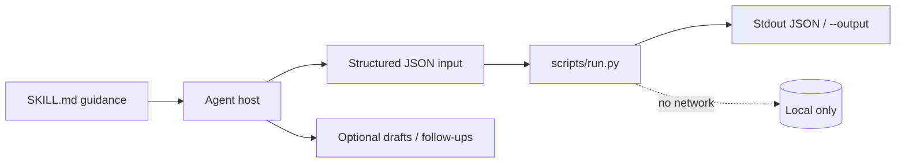
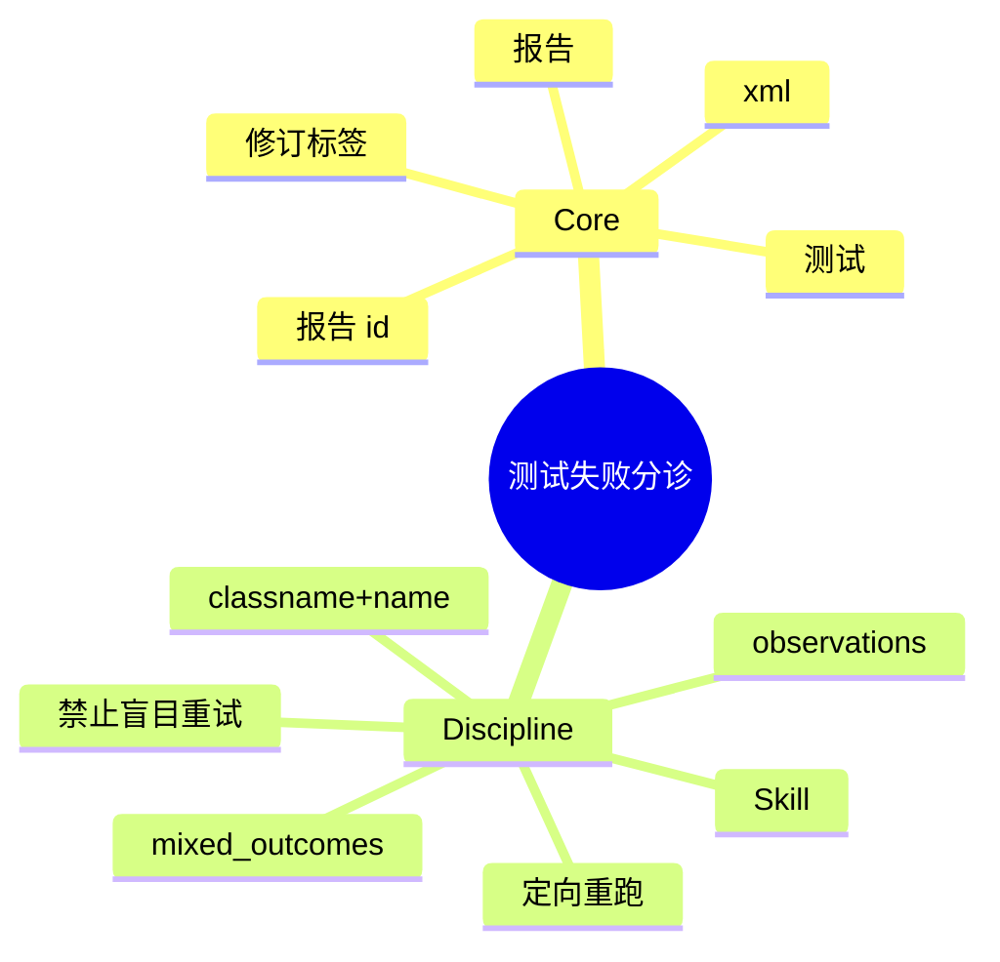

# 测试失败分诊

[English](README.md) · [中文](README.zh-CN.md) · **v0.2.1**

[](https://github.com/KarmenLoop/skill-test-failure-triage/actions/workflows/checks.yml)
[](https://github.com/KarmenLoop/skill-test-failure-triage/releases/latest)
[](https://www.python.org/downloads/)
[](LICENSE)
[](docs/COMPATIBILITY.md)

**把多份 JUnit 报告放在一起读——看清哪些测试持续失败，或在多次运行间翻转结果。**

一套 Agent Skill，外加本地 JUnit 聚合器：每条观察仍拴在所属报告、耗时与失败信息上。 导出（或会议文本、diff、账本、事件日志、JUnit XML）留在本地；辅助程序只用标准库，从不发起网络连接。Skill 层教宿主*何时*准备输入、*如何*陈述结果，以及在用户未授权的副作用前*停在哪里*。

由 [KarmenLoop](https://github.com/KarmenLoop) / [KARMENLOOP](https://karmenloop.com) 维护。当前发布：**[v0.2.1](https://github.com/KarmenLoop/skill-test-failure-triage/releases/tag/v0.2.1)**。许可证：**MIT**。


*v0.2.1 真实本地输出渲染图。[examples/expected.json](examples/expected.json) · [图像出处](docs/images/provenance.json)。*

[下载 v0.2.1](https://github.com/KarmenLoop/skill-test-failure-triage/releases/tag/v0.2.1) · [英文教程](docs/tutorial.en.md) · [中文教程](docs/tutorial.zh-CN.md) · [输入契约](docs/input.zh-CN.md)

---

## 为什么做这个

CI 界面常把失败压平。在有人手动对比运行之前，偶发与确定性缺陷看起来一样。

本辅助程序解析多份报告 XML，按测试身份分组，并在同一测试于提交集合中既失败又通过时标记 `mixed_outcomes`——**这是调查线索，不是偶发证明**。

Skill 推动先做隔离、时钟假设与共享资源清理，再谈弱化断言或盲目重试。

---

## 快照

| | |
|---|---|
| **安装内容** | Skill 树 + `scripts/run.py` JUnit 聚合器 + `install.py` |
| **运行时** | Python **3.9+**，仅标准库 |
| **网络** | **无** — 从不运行或修复测试 |
| **输入** | UTF-8 JSON：`reports[]`（`id`、`xml`）；拒绝 DTD/实体 |
| **输出** | 含观察与 `mixed_outcomes` 的 `tests[]`；来自 testcase 结果的 `totals` |
| **安装宿主** | `codex` · `deepseek` · `grok` · `agents` |
| **包标识** | `karmen-test-failure-triage` |
| **许可证** | MIT |

---

## 是 / 不是

| 是 | 不是 |
|---|---|
| 多报告 JUnit 聚合 | 测试运行器或偶发隔离服务 |
| 保留失败信息的混合结果线索 | 证明测试一定偶发 |
| 为更安全 XML 拒绝 DTD/实体 | 从 CI 远程拉日志 |
| 离线标准库辅助程序 | 自动修代码 |
| Skill 指导最小定向重跑 | 在 CI 中静音失败的权限 |

---

## 工作方式

两层有意分开：

1. **方法层（`SKILL.md`）** — 何时调用、如何准备诚实输入、交付什么，以及哪些副作用在没有新的用户授权时仍禁止。
2. **确定性辅助程序（`scripts/run.py`）** — 校验 UTF-8 JSON 契约（最大 10 MiB），本地计算，打印到 stdout（或新的 `--output`），非法输入以 `2` 退出。





### 流程

1. **收集**带修订、命令、退出码与运行环境的报告。解析成功不等于套件成功。
2. **对所有选定报告运行**辅助程序。归因前先看失败信息与相关日志。
3. **对混合结果**，检查隔离、时钟、共享资源与清理。避免用重试掩盖确定性缺陷。
4. **返回**最小定向重跑与可能归属——并仅在请求的诊断范围内执行。

### 示例证明什么

`save::roundtrip` 一次失败、一次通过。`totals` 记录两次观察，`mixed_outcomes` 为 true。

退出码 `0` 表示处理完成——不表示业务上「全部通过」。

---

## 快速开始

从 [v0.2.1 发布页](https://github.com/KarmenLoop/skill-test-failure-triage/releases/tag/v0.2.1) 下载 `karmen-test-failure-triage-v0.2.1.zip` 与对应 `.sha256`，校验哈希后解压。需要 Python 3.9+。

```sh
python3 scripts/run.py --version
python3 scripts/run.py --input examples/input.json
```

期望版本串：`karmen-test-failure-triage 0.2.1`。

可选：安装到会扫描 skills 目录的宿主（目标已存在则拒绝）：

```sh
python3 install.py --host agents
# 亦可：--host codex | deepseek | grok
# 或：  --destination /精确/新目录
```

完全可以不借助 AI 宿主直接跑辅助程序。宿主发现与调用方式仍因产品而异——见 [docs/tutorial.zh-CN.md](docs/tutorial.zh-CN.md) 与 [docs/COMPATIBILITY.md](docs/COMPATIBILITY.md)。

管道与版本探测：

```sh
python3 scripts/run.py --input - < examples/input.json
python3 scripts/run.py --version
```

---

## 用在你自己的工作上

准备新载荷前先读 [docs/input.zh-CN.md](docs/input.zh-CN.md)（或 [docs/INPUT.md](docs/INPUT.md)）。

- 每份报告给唯一 id 与原始 XML 文本。
- 调查混合结果时，加入来自已知修订的第三份报告。
- 把 commit、环境与命令与报告放在一起。
- 重复身份可能是参数碰撞——需人工检查。

辅助程序不需要模型账号、API 密钥或网络。AI 宿主有自己的数据与权限设置；本 skill 不授予发送、购买、发布或改权限的权力。

---

## 文档地图

| 文档 | 何时使用 |
|---|---|
| [教程（中文）](docs/tutorial.zh-CN.md) · [English](docs/tutorial.en.md) | 下载、安装、练习、升级、卸载 |
| [输入/输出契约（中文）](docs/input.zh-CN.md) · [EN](docs/INPUT.md) | 字段语义与示例 |
| [兼容性](docs/COMPATIBILITY.md) | 宿主安装路径与未验证边界 |
| [验证](docs/VALIDATION.md) | 实际跑过什么 |
| [来源](docs/SOURCES.md) | 设计背后的研究笔记 |
| [变更日志](CHANGELOG.md) | 发布历史 |
| [贡献](CONTRIBUTING.md) · [支持](SUPPORT.md) · [安全](SECURITY.md) | 协作与报告 |

---

## 验证（如实）

基线见 [docs/VALIDATION.md](docs/VALIDATION.md)：2026-10-18 (UTC) · Python 3.9.6 · macOS arm64 (see docs/VALIDATION.md)。

| 检查 | 结果 |
|---|---|
| `python3 scripts/run.py --input examples/input.json` | 退出 0；夹具与实跑输出对齐 |
| `python3 -m unittest discover -s tests -v` | 维护者环境退出 0 |
| `skill-creator` 快速校验 | 元数据通过 |

**未声称：** 每个支持宿主内的已登录对话、在线账号连接器，或 Windows/Linux 宿主 UI 全覆盖。安装在临时目录测过；模型如何解释仍是宿主责任。依赖调用前请确认精确的 `SKILL.md` 已被发现。

CI：[`.github/workflows/checks.yml`](https://github.com/KarmenLoop/skill-test-failure-triage/actions/workflows/checks.yml)。

---

## 常见问题

### 一句话：测试失败分诊是什么？

MIT Skill + 离线辅助程序：聚合 JUnit 报告，让重复失败与混合结果仍拴在证据上。

### mixed_outcomes 意味着可以忽略失败吗？

不意味着。核对修订/环境差异，刻意复现，并修复根因。

### 会跑我的测试吗？

从不。只读你提交的 XML。

### 允许 DTD 与实体吗？

不允许。为更安全解析而拒绝。

### 输出到哪？

stdout 或新的 `--output`；保留已有文件。

### 如何安装？

`python3 install.py --host agents`（也支持 `codex` / `deepseek` / `grok`）。

---

## 许可与联系

[MIT](LICENSE)。再分发时请保留许可证与 [声明](NOTICE.md)。

[karmenloop.com](https://karmenloop.com) · [GitHub @KarmenLoop](https://github.com/KarmenLoop) · [info@karmenloop.com](mailto:info@karmenloop.com)

KARMENLOOP Official Team · 上海

<!-- Copyright (C) 2026 KARMENLOOP Official Team
SPDX-License-Identifier: MIT -->
